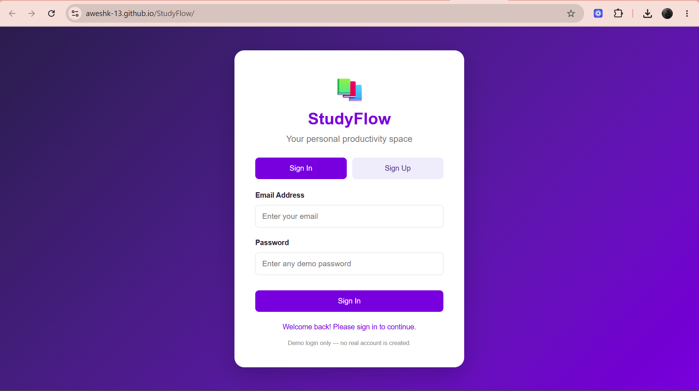
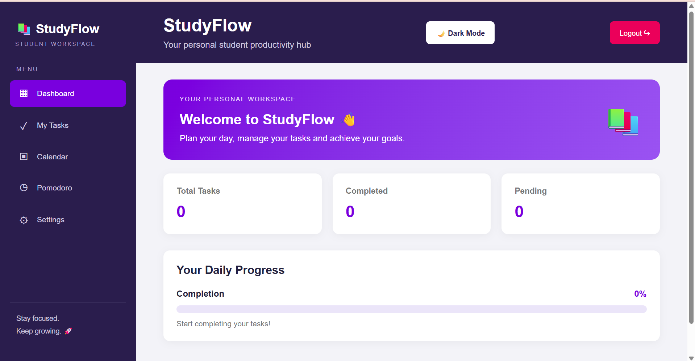
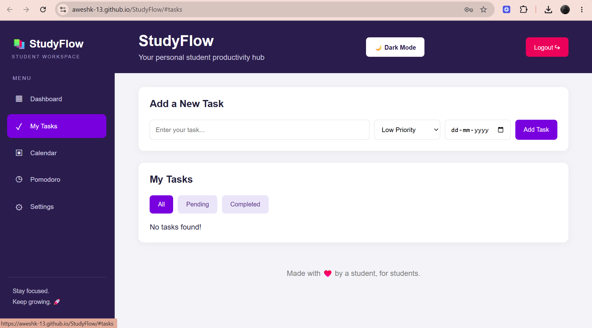
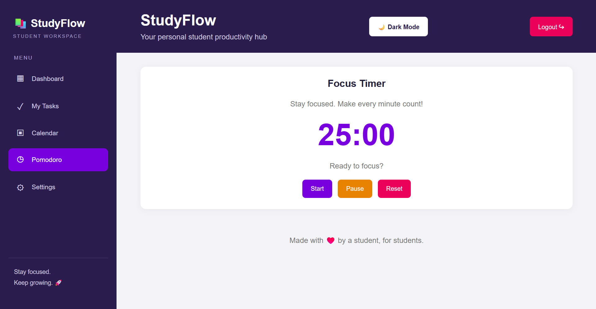

# 📚 StudyFlow – Student Productivity Dashboard

StudyFlow is a simple and interactive student productivity web application designed to help students manage their daily tasks, track progress, and improve time management.

It provides an organized workspace where students can plan their activities, monitor deadlines, and stay productive.

## ✨ Features

- **User Login Interface:** Demo Sign In and Sign Up screens.
- **Task Management:** Add, complete, and delete tasks.
- **Priority Management:** Set Low, Medium, or High priority.
- **Deadline Tracking:** Identify overdue, due today, and upcoming tasks.
- **Calendar:** View tasks with their due dates.
- **Pomodoro Timer:** Use a 25-minute focus timer.
- **Progress Dashboard:** Track total, completed, and pending tasks.
- **Dark and Light Mode:** Switch between themes.
- **Task Filters:** View all, pending, or completed tasks.
- **Local Storage:** Save tasks and theme preferences in the browser.

## 🛠️ Technologies Used

- HTML5
- CSS3
- JavaScript
- Browser LocalStorage

## 📂 Project Structure

```text
StudyFlow/
│
├── index.html
├── style.css
├── script.js
└── README.md
```

## 🚀 How to Run the Project

1. Download or clone this repository.
2. Open the project folder.
3. Open `index.html` in your web browser.
4. Sign in using the demo login interface.
5. Start managing your tasks!

## 🔐 Login Information

StudyFlow currently uses a demo login interface. It does not provide real account authentication or server-side data storage.

## 🎯 Project Objective

The main objective of StudyFlow is to help students organize academic activities, manage deadlines, monitor productivity, and develop better study habits through a simple web application.

## 👨‍💻 Developer

**Developed as a student project using HTML, CSS, and JavaScript.**

---

⭐ If you find this project useful, consider giving the repository a star!## 📸 Screenshots

### Login Page


### Dashboard


### Task Management


### Pomodoro Timer

## ✨ Features

- **User Login Interface:** Demo Sign In and Sign Up screens.
- **Task Management:** Add, complete, and delete tasks.
- **Priority Management:** Set Low, Medium, or High priority.
- **Deadline Tracking:** Identify overdue, due today, and upcoming tasks.
- **Calendar:** View tasks with their due dates.
- **Pomodoro Timer:** Use a 25-minute focus timer.
- **Progress Dashboard:** Track total, completed, and pending tasks.
- **Dark and Light Mode:** Switch between themes.
- **Task Filters:** View all, pending, or completed tasks.
- **Local Storage:** Save tasks and theme preferences in the browser.

## 🛠️ Technologies Used

- HTML5
- CSS3
- JavaScript
- Browser LocalStorage

## 📂 Project Structure

```text
StudyFlow/
│
├── index.html
├── style.css
├── script.js
└── README.md
```

## 🚀 How to Run the Project

1. Download or clone this repository.
2. Open the project folder.
3. Open `index.html` in your web browser.
4. Sign in using the demo login interface.
5. Start managing your tasks!

## 🔐 Login Information

StudyFlow currently uses a demo login interface. It does not provide real account authentication or server-side data storage.

## 🎯 Project Objective

The main objective of StudyFlow is to help students organize academic activities, manage deadlines, monitor productivity, and develop better study habits through a simple web application.

## 👨‍💻 Developer

**Developed as a student project using HTML, CSS, and JavaScript.**

---

⭐ If you find this project useful, consider giving the repository a star!
